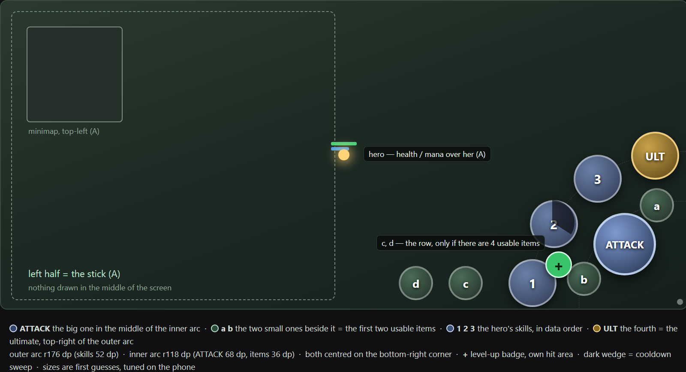

# Hero mode: playing as one hero on a phone

The gameplay this fork exists for. Everything else in the repo is plumbing that makes it possible.

## The idea

Warcraft III on a phone is an RTS, and an RTS is the wrong shape for a phone: squads, control groups, twelve
command buttons, drag-select, right-click-to-move, all of it designed for a mouse and a keyboard and two hands that
are not holding a screen.

So hero mode does not port the RTS. It keeps the world — the campaign, the maps, the units, the spells, the
economy — and changes who the player *is*:

- **the player is the hero.** One unit is under the player's fingers. Moving, aiming a skill, hitting something: that
  is what the left thumb and the right thumb do, nothing else;
- **the army plays itself.** Units follow the hero, fight what threatens them, retreat when they are losing, and do
  not need to be told. A good soldier here is one the player never has to think about;
- **the player still decides the war.** What gets built, what gets trained, where it goes — that stays with the
  player, but as a handful of macro decisions taken now and then, not as continuous micro.

The reference is a mobile MOBA (Mobile Legends / Wild Rift): one hero, a stick, four buttons, and a minimap. Not
StarCraft with a touchscreen.

The test of whether a piece of this is right: *if the player has to look away from the hero to do it, it is either
automatic or it is a macro decision.*

## The screen

Gone: the console along the bottom — the 4×3 command card, the portrait with its info panel, the inventory grid, the
control-group bar. That is the RTS surface, and it is the thing that makes the game unplayable on a phone.

Kept: the world, the minimap — moved out of the console's bottom-left slot to the **top-left corner**, since the
console it used to sit in is not built — the resource bar (gold, lumber, supply) at the top right, and health and mana
read **over the hero** herself, always, rather than in a portrait that is gone.

Added:

| where | what |
|---|---|
| bottom-left | **movement stick.** Drag anywhere in the left zone; the hero walks that way while the thumb is down |
| over the hero | **health and mana.** Her two bars, drawn every frame, not only while a finger rests on her |
| bottom-right | **skills**, 2 to 4 depending on the hero, in an arc where the thumb rests — plus the **usable equipment** |
| bottom-right, above | **macro panel**, opened deliberately: train, build, and what the army is doing |

The exact arrangement of the skill cluster, the equipment slots and the macro panel is settled later — the shape
above is what the doc is asking to be true, not the final layout. The skill cluster itself is settled: see
[the skill tray](#the-skill-tray).

### The skill tray

Two arcs centred on the bottom-right corner, so the whole cluster is under the right thumb and the middle of the
screen stays empty. The outer arc is the hero's four skills in data order, the ultimate last and therefore top-right.
The inner arc is the big attack button with the two small item buttons beside it; any further usable items go in a
row on the bottom edge, and four is the cap. Sizes in dp, all tuned on a phone:

| | radius from the corner | size |
|---|---|---|
| skills 1-4 | 149 | 44 |
| attack | 82 | 58 |
| items a, b | 100 | 30 |
| item row c, d | — | 30 |

The first draft of these numbers was 6/5 of this and read as heavy on a 480 dpi phone; the picture is drawn from the
table above.

A slot shows the icon inside a border about 3 dp thick, a cooldown wedge, a blue tint when the mana is not there, a
grey one when the spell cannot be used, and a "+" badge when there is a skill point this slot can take. The badge is
its own hit area, because a tap on the circle itself means cast. An item button also carries how many uses it has
left; a skill carries no number, because "1" on a freshly learned skill says nothing.

Which gesture a slot takes comes from a table of ability classes:

| type | gesture | preview |
|---|---|---|
| no target | tap | — |
| single target | tap, then tap the target | a ring around the hero showing the range |
| direction | drag | a line from the hero to the thumb |
| ground | drag | a circle of the spell's area |

A drag is measured from where the thumb went down, not from where it is: the aim starts on the hero and moves as far
and in the direction the thumb moved, so the circle can be walked around her and out past her cast range, and a thumb
that barely moved asks for a point beside her feet rather than at the corner of the screen where the tray sits.

Dragging back into the button cancels, tapping the chosen button again cancels, and so does pushing the stick. An
untargeted world tap does nothing — the stick is still the only way to move, and the one exception is a tap on an
item on the ground, which is a smart order on that item.

## The army

Units belong to the player but are not commanded one by one. Their standing orders:

- **follow** the hero as a formation: when the hero moves, the army receives the same group move the console gives a
  multi-unit selection — rank-sorted slots with the hero at the front of the block, marching at the army's own slowest
  pace, never slowing the hero, and settling around her when she stops;
- **engage** what comes within reach of the hero or of themselves — and keep fighting it even while the hero moves
  elsewhere; a fight is only left when the hero has run far off, and that order is a retreat, not a reposition; a unit
  that already has a target, or an idle unit with an enemy inside its own acquisition range, is not pulled out of it
  to reach a slot. The idle qualifier is load-bearing: the engine only auto-acquires an idle unit, so counting a unit
  in any other behaviour — a scripted hold, a unit standing on its slot — as fighting froze it beside a visible enemy
  it never picked up, held out of the army, for as long as the enemy stood there. Found on the phone as a unit frozen
  six seconds beside an enemy 805 away, and fixed by matching the engine's own gate.
- **make way** when the hero is wedged against her own squad — a dead end, a corridor she has to back out of: the army
  is sent on ahead of her, because the side with the free path goes first;
- **return** — an idle unit rejoins the formation on the hero's next move, so a fight that ends reforms the army for
  free; regrouping while the hero stands still is the script's job (D);
- **not die stupidly** — no walking into towers, no standing in the middle of nothing, no chasing a lone unit into a
  base.

Units that carry useful abilities (a healer, a caster) use them in support of the hero rather than at random.

## The macro layer

The player still builds and trains, because an army that also builds itself is a different game. What changes is the
form: a few decisions, taken at a good moment, with an obvious consequence.

- **train**: a short list of what this player can make, one tap each, queued at the building that makes it;
- **build**: the same for structures, with placement either chosen on the map or left to a sensible default;
- **see the army**: how many units, what they are, whether they are alive — without selecting anything.

Whether this is a panel, a radial menu or a row of icons is open.

## Where it lands in the code

The point of this section is that none of it needs a rewrite: the engine already has the seams.

| piece | anchor | note |
|---|---|---|
| the HUD that gets replaced | `core/src/.../w3x/ui/MeleeUI.java:117-265` (state), `:543-568` (build order), `:1015-1145` (the one draw call) | the whole HUD is one `UIFrame` tree under `rootFrame`; hero mode is a second HUD, not a patch to the console |
| the command card to remove | `MeleeUICommands.java:234-303` (4×3 grid), `:139-233` (inventory grid), `MeleeUI.java:134-140` (fixed sizes) | the inventory grid is the closest working example of a second button grid, so the skill tray has a template |
| a tap becoming an order | `MeleeUIInput.java:965-1010` (`rightClickMoveTo`), `MeleeUICommands.java:317-420` (`onClick`) → `CPlayerUnitOrderListener` | every order must go through this seam or replays and LAN break |
| skill buttons | `RenderUnit.java:180-201` (`populateCommandCard`), `CommandCardPopulatingAbilityVisitor.java:118-197`, `CAbilityHero.getLearnedHeroAbilities()` (`:316`) | the list is already there: `unit.getSimulationUnit().getAbilities()` filtered to icon-showing, active ones |
| equipment buttons | `CAbilityInventory.java:43-290` — each held item's abilities are already `CAbility` | a usable item is an ability button with `OrderIds.itemUseFirst + slot`; no new mechanism |
| follow camera | `GameCameraManager.setTargetController` (`:787-800`), `followTargetController` (`:164-205`) | **already exists**; the only UI caller today is press-and-hold on the portrait (`MeleeUIInfoPanel.java:1607-1618`) |
| stick → movement | `core/src/.../input/touch/` — `RtsTouchAdapter`, `GestureRecognizer`, `GestureListener`, `TouchSettings` | **no joystick code exists**; one-finger drag is currently selection box *or* aim, two-finger drag is camera pan, so the stick needs its own zone and a new gesture |
| swapping the HUD | `MeleeToggleUI` (`ui/toggle/`), `WarsmashGdxMapScreen.java:315` | the seam exists: the HUD is a list of `WarsmashToggleableUI` that Alt+Z cycles, and today the list holds one entry, so hero mode is a **second entry**, not a replacement |
| units following the hero | `CHeroArmy.java` (the rule: who walks, who keeps fighting, the 1000), called from `HeroMode.issueMoveOrder` and `HeroMode.updateArmy`; `CGroupMove.java:120-246` (`slots`), `:44-113` (`linkMoving`, `limitSpeed`), `MeleeUIInput.java:945-1013` (the console's own caller) | **hero-mode follow is the console's formation group move, not `CBehaviorFollow`.** That behavior exists (`:41-44`, issued from `CAbilityMove.java:203`) but its `update` plays STAND and never looks for targets — an army on it would walk with you and never fight. `CGroupMove.slots` instead gives each follower a rank-sorted slot around the hero's destination, and the wire format already carries per-unit arrays |
| units fighting for themselves | `CUnitAcquisition` (`autoAcquireIdleTargets` `:95`, `autoAcquireTargets` `:57-93`) | this is the per-unit brain, and it is where hero-mode unit behaviour belongs — **not** in the JASS AI |
| train / build | `CAbilityQueue.java:27-41` (train list), `AbstractCAbilityBuild.java` (build list), `MeleeUICommands.java:422-460` (submenu stack) | the macro panel is a different projection of the same lists the command card shows today |
| computer players | `parsers/jass/ai/AIController.java`, `AIProduction`, `AIAttack` | untouched: the *enemy* keeps playing RTS |

Two consequences worth stating before any code:

1. **The hero-mode HUD is a sibling of the console, not a skin on it.** The console is positioned by literal viewport
   fractions and a 4×3 cap; a touch tray wants its own frames and its own hit areas.
2. **The orders still have to be orders.** The stick and the skill buttons must end in
   `CPlayerUnitOrderListener.issue*Order`, exactly like a right-click does, or a LAN game and a replay stop agreeing
   with the screen.

## Decided

Settled, and no longer up for renegotiation without a good reason:

1. **Hero mode is the game, not a mode.** There is no RTS interface on the phone and no way back to one. No Alt+Z
   cycle, no corner button: the console is simply not built for phone play.
2. **The hero is the first hero of the local player**, in campaigns and in custom games alike. Campaign maps that
   move the view to a different hero mid-map are a known exception, to be handled when one is met.
3. **The player never touches a unit.** Units are not selectable, not orderable, not groupable.
4. **The stick is the only way to move.** No tap-to-move. This is a thumb game, not a mouse game.
5. **The stick floats, but only in the left zone.** It appears under the thumb that lands in the left region of the
   screen (never over the minimap), and a right-side touch never starts it.
6. **One-finger drag on the right side looks around**, and the camera returns to the hero when the finger lifts. A
   drag on the minimap looks too, since a tap there has nothing to do: no selection to order, and a camera the hero
   would pull straight back.
7. **Skills aim by dragging from their button** and cast on release; no-target skills fire on tap.
8. **Multiplayer is not a target yet**, but nothing in the design may exclude it — hero mode is the shape there too.
9. **Four skill slots, always visible**, with the ultimate at the top-right of the arc. Passives take a slot like
   actives, so the tray never shifts while levelling. How many are active and how many passive is a balance question
   for after the core loop works.
10. **Levelling is a "+" on the button**, tapped to spend a point — the moba gesture, not a separate window.
11. **Skill buttons are circles.** Warcraft's ability icons are square and stay square on disk; the circle is the icon
    masked at load, with a ring drawn the way the stick's is.
12. **Tapping an item on the ground walks the hero to it and picks it up** — the one tap that orders movement.

13. **Health and mana are drawn over the hero, always.** The portrait panel that held them belongs to the console and
    is not built; a phone has no hover, so the bars are simply there. Cooldowns and level join them in B.
14. **The console is not built for a hero map.** Two of its pieces outlive it: the minimap moves to the top-left
    corner, the resource bar stays at the top right, and the quest/menu/chat buttons move beside the minimap. Nothing
    brings the console back — there is no key for it, and the one exception is a map with no hero for the local
    player, which plays on the console because hero mode would have nothing to hand the player.
15. **When the hero moves, the army moves in formation, and the hero keeps the front of it.** Each idle follower
    gets a `CGroupMove` slot — the engine's own group move, rank-sorted so melee front and ranged back are
    data-driven — but the block's front row stands on the hero's own line, because `CGroupMove` centres its rows on
    the point it is given and a block centred on her destination walks inside her and body-blocks her (the first
    phone run). The front line is her position for a melee hero, who wants the army behind her, and her position
    plus her own attack range for a ranged one, who fights from behind the rank in front of her. When she stops, the
    army forms up around her rather than walking on to the point the last stick order named. The hero is excluded
    from the group's speed link: the stick answers at the hero's own speed, and the army links among itself so it
    marches as one block.
16. **A fighting unit ignores hero movement** and keeps its target while the player moves, casts and attacks freely.
    Only a hero more than **1000** away turns the order into a retreat: break combat, join the formation. The
    distance is a tuning knob, and it is also the chase cap — nothing pursues an enemy that far from the hero. A unit
    counts as fighting when it is attacking, attack-moving, walking to a target it already picked, or standing with an
    enemy inside its own acquisition range; the last case is what keeps the army from marching through a battle to
    reach its slots, and it is bounded by the same 1000 retreat, so it cannot keep a unit away for good.
17. **The army is every movable unit the local player owns minus the hero**, re-derived per order. No roster is
    kept; `CGroupMove.canTakeSlot` already excludes buildings and zero-speed units.
18. **She crosses the army; the army never crosses her.** The engine never pushes a unit aside
    (`CBehaviorMove` refuses a step into another unit's footprint, `CUnitPlacement` only separates units that stand
    still), and a unit ordered to a point **walks straight at it** — no avoidance, no re-path — so a unit sent to a slot
    with her body on the way jams on her. That one fact is what killed both earlier attempts at "make way": a stuck
    timer that sent the block ahead for one second and then called it back through her, and a one-cell step aside that
    the next slot order walked straight back. Both are gone, and the rule is now per unit per beat, with no timer and
    no memory:

    - **A unit in the ground she is walking into keeps its place.** `placeBehind` already leaves every slot at or
      behind her front line, so a unit ahead of her could only reach its slot by walking back across her: it is given
      no order at all, and stays where it stands. This is what a reversed stick produces on its own — every unit of the
      block is ahead of her along the new way, so the whole block holds instead of marching through her.
    - **The unit on the step she is about to take moves one cell aside** (`CUnitPlacement.blockedByUnit` is the test,
      the side the unit already leans to is the choice, both sides tried, and the unit sits out that beat so the order
      does not call it back). A unit in a fight is never the one moved.
    - **Once she is past a unit, its slot is on her side of her line and it follows** — the front line first, then the
      rank behind it as she walks past that too. The walker blocked by that rank steps it aside; the rank itself does
      not move until then.
    - **The chase cap is exempt**: a unit more than `RETREAT_DISTANCE` out comes home whether or not she is between it
      and the block.

    What the phone sees: she walks into the squad, they part one at a time as she reaches them, and the block reforms
    behind her with the melee nearest her, because rank decides the rows, not proximity.
19. **Four cast types, and the type is a table, not a probe.** No target fires on a tap; single target takes a tap
    to choose and a tap on the target to cast; direction and ground both aim by dragging, and differ only in the
    preview — a line from the hero, or a circle of the spell's area. Nothing in the ability data says "directional",
    and several spells the 1.29 data declares are not implemented at all, so the table maps ability classes (with
    rawcode overrides) and anything outside it falls back on what the spell accepts.
20. **An aim is a drag from the press, scaled to the spell, and stopped at its range.** The skill button is at the
    corner of the screen and the hero is in the middle: reading the thumb absolutely would put the circle where the
    button is the moment it is pressed, and every drag would move the circle the wrong way. So the press point is the
    origin, the direction is the one the thumb went, and the distance is the drag scaled by range over 80 dp — a
    sweep of about the tray-to-hero gap fills the ring for a short spell and a long one alike, which is what makes
    the ring mean something. Past the ring the circle stops: a spell's reach is what the ring shows, and the engine
    walks a caster into range of a target beyond it.
    Two numbers the phone supplied: laying the world point of the finger straight onto the map (1:1) put the far end
    of any range out of reach, and the data's unlimited range — Blink declares 99999 — used as a scale put the circle
    ten thousand units away. A declared range at or above 5000, or none at all, now scales and stops at 1200.
21. **A cast keeps the walk stick's orders off for its own moment.** A move order interrupts a spell here, as in the
    game the engine comes from, and a held stick re-issues its move order every few frames, so every skill cast while
    walking was cancelled before it fired — instant ones included, because a cast with an animation is still a cast.
    For `HeroCastHold`'s time, the stick issues nothing; the thumb keeps its direction and takes over again when the
    hold ends, so the hero stops, casts, and carries on. The time is per skill (300 ms was too short for both Fan of
    Knives and Blink; 700 and 800 are measured on the phone), it is a table rather than a data field because nothing
    in the ability data describes a cast's length — a unit's cast point is only a multiplier on a model's spell
    sequence — and 1500 ms is the ceiling whichever skill asks.
22. **The item buttons are the inner arc.** The first two usable items sit beside the big attack button, the rest in
    a row on the bottom edge, four at most. "Usable" is the data's own flag for an item that is actively used; an
    item that cannot be used right now is drawn disabled, and an item with no active use gets no button at all.
23. **The big attack button gives target focus, and the hero never fights on her own.** She swings only when the
    button is tapped: her own target scan is off, so an enemy that walks up to a standing hero is ignored. The button
    orders an attack on the nearest thing in reach, so a hero can be picked out of the crowd — and so a gate can be
    broken. What it may pick is not "an enemy": a destructable gate and a Neutral Passive building are legitimate
    targets, because Neutral Passive is allied to everybody only so that a right click walks instead of attacking.
    The hero's own side is not, which is why the rule asks `isNeutralPassive` rather than the alliance alone. The order
    is not the smart order a right click sends — a smart order on a neutral building is a walk by design.

    **One tap, one swing.** The order is `attackonce`, not the sustained `attack`: after the swing the hero stops
    unless the button is tapped again. A tap that lands after the swing it repeats has landed its hit is remembered
    rather than lost, and it arms one more swing on the behaviour that is already running instead of re-ordering her.
    That distinction is the whole feature: a fresh attack order wipes the backswing latch, the cooldown snapshot and
    the wait before the first swing, so re-ordering per tap would cost up to a quarter second before every swing and
    feel mushy. A tap that lands *before* that hit — in the windup, or before the swing has even started — buys
    nothing, because it is the previous tap's impatience rather than a second intent: that is why a quick double tap
    is one attack and not two. One arm at most, so a burst of taps still buys one swing; a queue would let a masher
    stock swings and would be auto-attack through the back door. A tap on a different target is a new order, which is
    a new engagement and is meant to settle briefly.

    **A tap while walking.** With a thumb on the stick the player has already said where she is going, so the tap
    chases only a step: a target she can reach within a quarter second of walking, and it gives up the moment the
    target outruns that — a chase across the lane would take her somewhere the player did not send her. Standing still,
    the tap still
    walks her into range as far as the acquisition range. While the swing she asked for is owed, the stick's move
    orders go quiet: a move order ends the attack behaviour before its damage point, so without the quiet the swing
    was ordered and taken back in the same frame, and the button did nothing at all while walking. A swing that has
    started is finished whatever the thumb does, for the same reason, and the thumb's direction is not lost: she walks
    again the moment the swing is over, without a lift and a re-press. Letting go of the stick mid-swing sends no stop
    either: the attack ends on its own and leaves her standing. That quiet only covers a swing the button bought, so a
    script that orders the hero to attack still lets the player walk her out of it.
24. **The circle is cut from a private copy of the icon.** The game hands the same texture to the card, the tooltips,
    the item icons and the portrait, so an alpha mask written into it would round the corners everywhere it is used;
    the tray keeps its own masked copy per icon.
25. **A finger on the tray aims while the other thumb walks.** The gesture layer learns a second pointer, so a press
    on a skill does not have to lift the stick first; a second finger that is not on the tray stays a camera pan.
Two consequences that were not obvious when the design was written:

- **the hero must be able to attack.** With no right-click and no attack button she could never fight, which is why
  the button exists at all. That was first built as an auto-acquire so she would fight while the player was busy, and
  the phone rejected it: a hero who picks her own fights makes the player feel she is not under their control. She now
  fights only when the button is tapped, one swing per tap.
- **a mission with no hero cannot be hero mode.** Rather than hand the player a dead screen, hero mode stays inert
  and the RTS console is used for that mission until hero play can cover it.

Five things the first run on the phone corrected, all of them places where the console was doing work nobody had
noticed:

- **`CPlayer.getHeroes()` is not every hero.** It is only filled by `CreateUnit`, so a hero placed in the map, or one
  restored from a saved game, is missing from it — which is most campaign missions. Hero mode reads the player's units
  as well, ordered by handle id.
- **the world was letterboxed for a console that is not drawn.** The world viewport stops 0.21 of the height above the
  screen bottom to leave room for the console; in hero mode it takes the whole screen, the way a Reforged cinematic
  already did, and the camera's projection height scale goes back to 1.
- **the hero's portrait is a 3D scene, not a frame.** Hiding `UnitPortrait` hides a frame that holds nothing; the scene
  has to be turned off, and `positionPortrait` must not turn it back on.
- **the resource bar and the quest/menu/chat buttons are children of `ConsoleUI`.** A hidden frame draws none of its
  children, so they are moved to the root; their set points still name the console, which keeps being laid out.
- **the control group bar, and the Shift button it draws, are not console frames.** They are drawn for any touch
  scheme while the interface alpha is above zero, so hero mode has to say no explicitly.

And one geometry trap: the interface is a 4:3 box centred in a wider viewport, so its x 0 is not the screen's left
edge. Anything hero mode puts in a corner is offset by `(minWorldWidth - worldWidth) / 2`.

## Still open

1. **The engagement rules** (issue D): what a unit will engage, when it retreats by judgment rather than by the
   hero's distance, how it regroups to the hero — or to the altar, when the hero is unspawned — while the hero
   stands still.
2. **Where the macro panel lives** (issue E) and whether building placement is chosen by hand at all.
3. **Campaign exceptions**: missions that switch heroes, missions with no hero, missions built around controlling
   several units at once.

## The five issues

Each is one branch and one PR. A and B are the interface, C and D are the simulation, E is the economy.

| | issue | covers |
|---|---|---|
| A | hero shell and stick | console gone, camera on the hero, minimap to the top-left, health and mana over the hero, floating left stick, one-finger look-around, hero auto-attack |
| B | skills and equipment | 2–4 skill buttons with drag-to-aim, usable items as buttons |
| C | the army follows | hero moves → the army moves in formation (`CGroupMove` slots, army speed-linked, hero never slowed); a fighting unit ignores hero movement until the hero is **1000** away, then it is a retreat |
| D | the army fights | engagement and chase limits in `CUnitAcquisition`, opt-in per player, plus support casting |
| E | macro panel | train and build from the lists the command card already reads |

## The stick's art

The stick is drawn in code — two rings and a knob — so it needs no asset and no licence: no game's artwork is copied,
and the proportions can be tuned on a phone in one build. If it later deserves a texture, engine resources
(`files/resources`, the folder `SmashFrameDef.toc` already comes from) can carry a PNG without touching `core`.

## Out of scope

- changing how the *enemy* plays — the AI keeps being an RTS opponent;
- removing the console for good: campaign, melee and LAN keep working while hero mode is being built;
- a desktop or Windows path of any kind.
